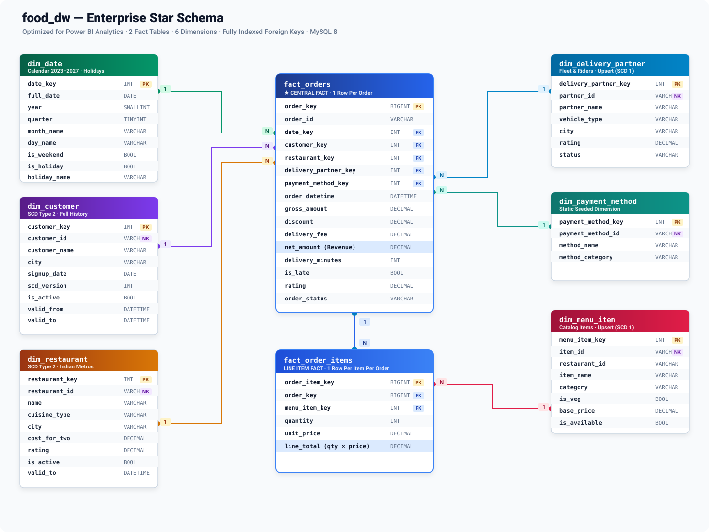

# Food Order ETL Pipeline

**End-to-end data engineering project: a batch ETL pipeline for a simulated
food-delivery platform (in the style of Zomato / Swiggy), built with Python,
MySQL 8, Docker and Power BI.**

Synthetic order and master data is generated with Faker. Python extracts it
and bulk-loads it into a raw staging layer. MySQL stored procedures then cleanse
and transform it into a star-schema warehouse. Data quality rules are stored as
rows in a table, and every run is logged to a control database that Power BI
can report on.

> **Status: in progress.** The Docker setup, all database DDL and the data
> generators exist. Ingestion, stored-procedure ETL, the DQ engine,
> orchestration and tests are still being built. See [Roadmap](#roadmap).

---

## Table of contents

- [Architecture](#architecture)
- [Tech stack](#tech-stack)
- [Data model](#data-model)
- [Key design decisions](#key-design-decisions)
- [Project structure](#project-structure)
- [Getting started (Windows + Docker Desktop)](#getting-started-windows--docker-desktop)
- [Verifying the setup](#verifying-the-setup)
- [Connecting Power BI](#connecting-power-bi)
- [Suggested DAX measures](#suggested-dax-measures)
- [Suggested report pages](#suggested-report-pages)
- [Roadmap](#roadmap)
- [Future enhancements](#future-enhancements)

---

## Architecture


| Layer | Responsibility |
|---|---|
| **Sources** | Seeded Faker data (`en_IN`): customers, restaurants, menu items, delivery partners, payment methods, and daily orders with lunch/dinner peaks, weekend spikes, ~5% cancellations and ~2–3% deliberately dirty rows |
| **Ingestion** | Python package that extracts files, checks their structure, flattens the JSON, bulk-loads into staging and moves each file to `archive/` or `error/`. No business logic |
| **Staging** | Raw copies stored as loose `VARCHAR`, plus `batch_id`, `source_file` and `loaded_at`. Bad rows are moved to `stg_rejected_records` |
| **Processing** | One stored procedure per target table: cleansing, business rules, surrogate keys, SCD Type 2, watermark-based incremental upserts, and job logging |
| **Warehouse** | Star schema: 2 fact tables and 6 dimensions, with every foreign key indexed |
| **Control** | Job and error logs, rule-driven data quality, pipeline metadata and watermarks |
| **Orchestration** | `run_pipeline.py` runs the steps in order and stops if an earlier step fails. APScheduler runs it on a schedule inside the container. Failures trigger a console, webhook or email alert |

📐 Detailed diagrams (orchestration flow, ER diagram, container topology):
**[docs/ARCHITECTURE.md](docs/ARCHITECTURE.md)**

---

## Tech stack

| Area | Tools |
|---|---|
| Language | Python 3.11 (type-hinted, modular packages) |
| Database | MySQL 8.0 (stored procedures, star schema) |
| Data handling | pandas, SQLAlchemy 2, PyMySQL |
| Data generation | Faker (`en_IN` locale, seeded for reproducibility) |
| Mock source API | FastAPI + Uvicorn |
| Scheduling | APScheduler |
| Containers | Docker Compose (MySQL, ETL, mock API, Adminer) |
| Testing | pytest |
| Reporting | Power BI Desktop |

---

## Data model



| Table | Grain / type | Notes |
|---|---|---|
| `fact_orders` | One row per order | `net_amount = gross_amount - discount + delivery_fee`; `is_late` flag; mapped `order_status` |
| `fact_order_items` | One row per item per order | `line_total = quantity × unit_price` |
| `dim_customer` | SCD Type 2 | Full history of customer attribute changes |
| `dim_restaurant` | SCD Type 2 | Full history of restaurant attribute changes |
| `dim_menu_item` | SCD Type 1 | Upsert on `item_id` |
| `dim_delivery_partner` | SCD Type 1 | Upsert on `partner_id` |
| `dim_payment_method` | Static | Seeded at init |
| `dim_date` | One row per day, 2023–2027 | Weekend flag plus Indian national holidays and festivals (Holi, Eid, Dussehra, Diwali) |

---

## Key design decisions

- **Business logic lives in SQL, not pandas.** Python only moves data.
  Transformations run inside MySQL stored procedures, close to the data, and
  each procedure logs to `etl_job_log` with a `DECLARE EXIT HANDLER FOR SQLEXCEPTION`.
- **Staging is lossless.** Every column is stored as `VARCHAR`, so a malformed
  value never breaks the load. Rows are rejected later, with a recorded reason.
- **Idempotent by design.** Each batch has a predictable `batch_id`, staging is
  cleared per batch, facts are upserted on their natural key, and SCD2 only
  versions a row when its attributes actually change. Re-running a day doesn't
  create duplicates.
- **Data quality rules are rows, not code.** `food_control.dq_rules` holds SQL
  checks (null, range, referential, freshness) with a `WARN` or `FAIL`
  severity. Adding a rule needs no code change.
- **Mock API over plain files.** Real platforms send orders over HTTP, so the
  pipeline pulls them from a FastAPI endpoint. Each response is saved to the
  landing zone so it can be replayed.
- **No secrets in the repo.** Every credential comes from `.env`, which is
  git-ignored. Application users are created by an env-driven init script.
- **Least privilege for reporting.** Power BI uses a dedicated `SELECT`-only
  user that can't see the raw staging data.

---

## Project structure

```
food-order-pipeline/
├── docker-compose.yml          # mysql, mock_api, etl, adminer
├── .env.example                # copy to .env and set real passwords
├── .dockerignore               # keeps .env and data out of images
├── requirements.txt            # exact pins for reproducible builds
├── docs/
│   ├── ARCHITECTURE.md         # detailed diagrams
│   └── images/                 # README images (architecture, star schema)
├── docker/
│   ├── etl/                    # ETL image (Python 3.11) + entrypoint
│   └── mock_api/               # FastAPI image
├── sql/
│   ├── init/                   # runs automatically on first MySQL boot
│   │   ├── 01_create_databases.sql
│   │   ├── 02_create_staging_tables.sql
│   │   ├── 03_create_control_tables.sql
│   │   ├── 04_create_dw_tables.sql
│   │   ├── 05_seed_control_data.sql
│   │   ├── 06_init_dim_date.sql
│   │   └── 10_create_app_users.sh
│   └── procedures/
├── src/
│   ├── config.py               # all settings from environment variables
│   ├── generator/              # Faker data generators + mock orders API
│   ├── ingestion/              # extract · validate · parse · load
│   ├── processing/             # stored-procedure runner
│   ├── quality/                # rule-driven DQ engine
│   ├── orchestration/          # pipeline runner, scheduler, notifier
│   └── utils/                  # DB engine, logging, connectivity check
├── tests/
├── data/
│   ├── landing/                # incoming files
│   ├── archive/                # processed files
│   └── error/                  # files that failed validation
└── logs/
```

---

## Getting started (Windows + Docker Desktop)

### Prerequisites

- Windows 10/11 with **Docker Desktop** (WSL 2 backend), running
- **Git**
- **Power BI Desktop** plus **MySQL Connector/NET 8.x** (needed by Power BI's
  MySQL connector)

### 1. Clone the repository

```powershell
git clone https://github.com/amity6118/Food-Pipeline.git
cd Food-Pipeline
```

### 2. Create your `.env`

```powershell
Copy-Item .env.example .env
notepad .env
```

Replace every `change_me_*` value with your own password. Don't use single
quotes in passwords. If a local MySQL server already uses port 3306, set both
`HOST_MYSQL_PORT=3307` and `MYSQL_PORT=3307`.

### 3. Build and start the stack

```powershell
docker compose up -d --build
docker compose ps -a
```

The first boot takes about a minute while MySQL runs its init scripts. Expected
state:

| Service | Status |
|---|---|
| `food_order_mysql` | Up (healthy) |
| `food_order_mock_api` | Up (healthy) |
| `food_order_adminer` | Up |
| `food_order_etl` | Exited (0): it runs a connectivity check and stops. The scheduler replaces this in a later phase |

```powershell
docker compose logs etl
```

```
[...] [INFO] [src.utils.healthcheck]: food_staging  OK (7 tables)
[...] [INFO] [src.utils.healthcheck]: food_control  OK (5 tables)
[...] [INFO] [src.utils.healthcheck]: food_dw       OK (8 tables)
```

Re-run the check at any time with
`docker compose run --rm etl python -m src.utils.healthcheck`.

### 4. Reset from scratch (optional)

The init scripts only run on the first boot of an empty volume. To rebuild the
databases from scratch:

```powershell
docker compose down -v
docker compose up -d --build
```

---

## Verifying the setup

Open a MySQL shell in the container (it asks for the root password from `.env`):

```powershell
docker exec -it food_order_mysql mysql -uroot -p
```

```sql
SHOW DATABASES LIKE 'food_%';
-- food_control, food_dw, food_staging

SELECT COUNT(*) AS days, MIN(full_date), MAX(full_date) FROM food_dw.dim_date;
-- 1826 | 2023-01-01 | 2027-12-31

SELECT full_date, holiday_name FROM food_dw.dim_date
WHERE is_holiday = 1 AND year = 2026 ORDER BY full_date;
-- New Year's Day, Republic Day, Holi, Eid-ul-Fitr, ... Diwali, Christmas Day

SELECT COUNT(*) FROM food_control.dq_rules;        -- 10
SELECT COUNT(*) FROM food_dw.dim_payment_method;   -- 6

SELECT user, host FROM mysql.user WHERE user IN ('etl_user', 'powerbi_reader');
SHOW GRANTS FOR 'powerbi_reader'@'%';
-- SELECT on food_dw.* and food_control.* only
```

**Adminer** (browser UI): http://localhost:8080. Use System `MySQL`, Server
`mysql`, and the `etl_user` credentials from `.env`.

**Mock API:** `Invoke-RestMethod http://localhost:8000/health` returns
`status: ok`. Interactive docs are at http://localhost:8000/docs.

---

## Connecting Power BI

1. In Power BI Desktop, go to **Get Data → MySQL database**.
2. **Server:** `localhost:3306` (or the `HOST_MYSQL_PORT` you set).
   **Database:** `food_dw`.
3. **Data connectivity mode:** Import (recommended for this data volume).
4. On the credentials screen choose the **Database** tab and enter
   `POWERBI_USER` / `POWERBI_PASSWORD` from your `.env`.
5. Load the `fact_*` and `dim_*` tables. Power BI detects most relationships
   on the `*_key` columns. Mark `dim_date` as the date table.
6. For the pipeline-health page, add a second MySQL source using database
   `food_control` (`etl_job_log`, `dq_results`).

If the connector reports a missing driver, install **MySQL Connector/NET** and
restart Power BI Desktop.

---

## Suggested DAX measures

After status mapping, order status values are `DELIVERED`, `CANCELLED` and
`REFUNDED`.

```dax
Total Orders = COUNTROWS ( fact_orders )

Delivered Orders =
CALCULATE ( [Total Orders], fact_orders[order_status] = "DELIVERED" )

GMV =
CALCULATE ( SUM ( fact_orders[gross_amount] ), fact_orders[order_status] = "DELIVERED" )

Net Revenue =
CALCULATE ( SUM ( fact_orders[net_amount] ), fact_orders[order_status] = "DELIVERED" )

AOV = DIVIDE ( [GMV], [Delivered Orders] )

Cancellation Rate =
DIVIDE (
    CALCULATE ( [Total Orders], fact_orders[order_status] = "CANCELLED" ),
    [Total Orders]
)

On-Time % =
DIVIDE (
    CALCULATE ( [Delivered Orders], fact_orders[is_late] = 0 ),
    [Delivered Orders]
)

Avg Rating = AVERAGE ( fact_orders[rating] )   -- blanks (unrated orders) are ignored

Repeat Customer % =
VAR CustomerOrders =
    ADDCOLUMNS (
        VALUES ( dim_customer[customer_id] ),     -- natural key, so SCD2 versions count once
        "@orders", CALCULATE ( COUNTROWS ( fact_orders ) )
    )
RETURN
    DIVIDE (
        COUNTROWS ( FILTER ( CustomerOrders, [@orders] > 1 ) ),
        COUNTROWS ( FILTER ( CustomerOrders, [@orders] > 0 ) )
    )
```

---

## Suggested report pages

| Page | Contents |
|---|---|
| **Executive Overview** | KPI cards (Total Orders, GMV, AOV, Cancellation Rate, On-Time %, Avg Rating), daily GMV trend, orders by city |
| **Sales** | GMV by month, weekday × hour heatmap (lunch/dinner peaks), payment-method mix, discount impact, holiday vs. normal days |
| **Customers** | New vs. repeat customers, Repeat Customer %, top customers, orders by city/state |
| **Restaurants** | Top restaurants and cuisines by GMV, ratings vs. delivery time, top-selling menu items (from `fact_order_items`) |
| **Pipeline Health** | Runs per day by status, rows read/inserted/rejected per job, run duration trend, DQ rule pass/fail by severity (from `food_control`) |

---

## Roadmap

| Phase | Scope | Status |
|---|---|---|
| 1 | Docker Compose, project skeleton, environment config | ✅ Done |
| 2 | Databases, staging/control/warehouse DDL, `dim_date`, Power BI user | ✅ Done (SCD2 columns pending) |
| 3 | Faker generators, dirty-data injection, mock orders API | 🚧 Generators done, API serves `/health` only |
| 4 | Ingestion package (extract, validate, parse, load, archive) | ⏳ Planned |
| 5 | Stored-procedure ETL (dimensions, SCD2, facts, watermarks) | ⏳ Planned |
| 6 | Data quality engine and structured logging | ⏳ Planned |
| 7 | `run_pipeline.py` orchestrator, scheduler, failure alerts | ⏳ Planned |
| 8 | pytest suite, staging ↔ warehouse reconciliation script | ⏳ Planned |

---

## Future enhancements

- **Apache Airflow** to replace APScheduler with DAG-based orchestration,
  retries, backfills and a UI.
- **Apache Kafka** for streaming order events instead of daily batch drops.
- **Apache Spark** to transform at scale once volumes outgrow a single MySQL instance.
- **dbt** for version-controlled, tested SQL models alongside or instead of stored procedures.
- **Cloud deployment** on a managed database (AWS RDS / Azure Database for
  MySQL) and container runtime, with Power BI Service scheduled refresh.
- **CI/CD** with GitHub Actions: lint, run pytest, and spin up MySQL to run SQL
  integration tests on every push.

---

## Author

**Amit Yadav** · [GitHub @amity6118](https://github.com/amity6118)
