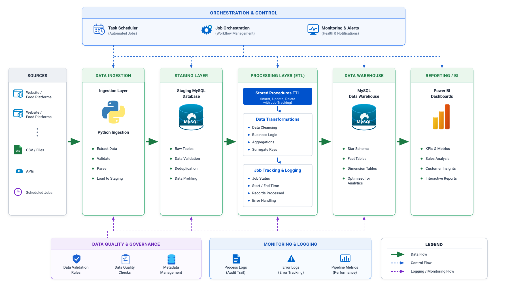
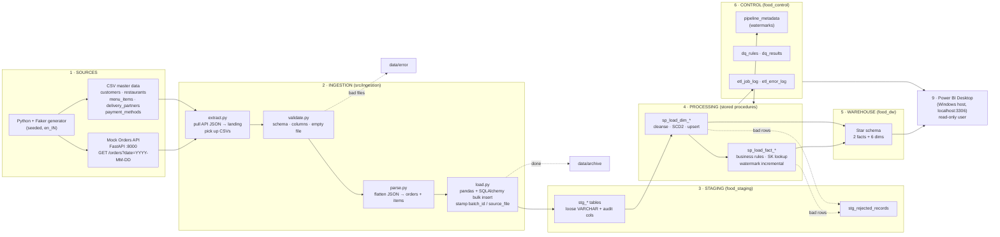
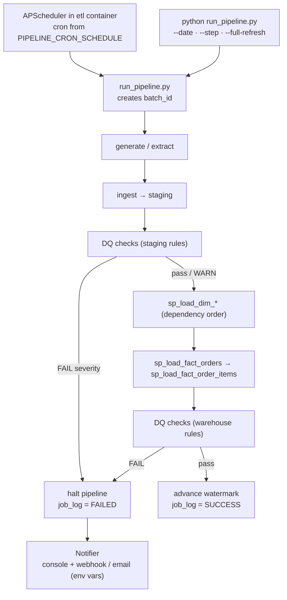
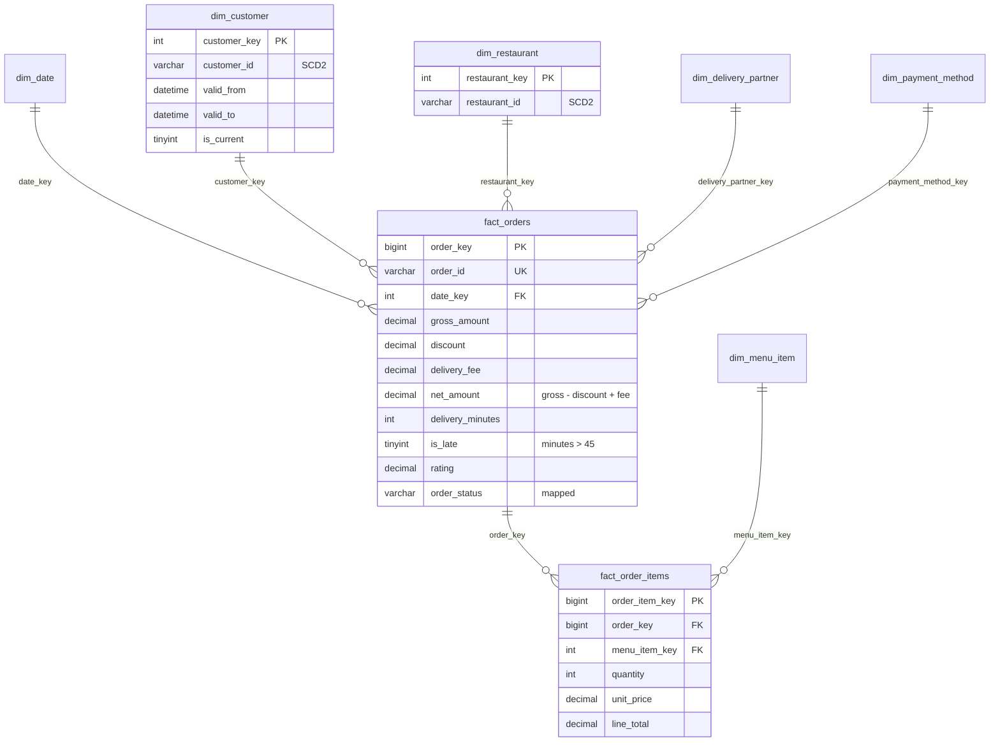
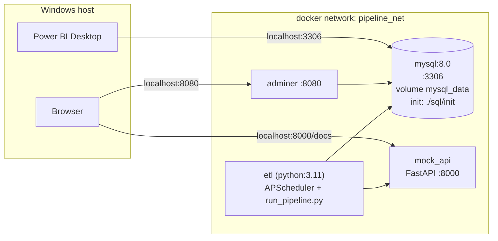

# Architecture — Food Order ETL Pipeline

This document describes how data moves from simulated food-delivery sources
through a MySQL staging layer, stored-procedure transformations and a star-schema
warehouse, to Power BI. It also covers orchestration, data quality and the
Docker runtime topology.

## 1. End-to-end data flow





## 2. Orchestration and control flow



- Each step writes a `RUNNING` row to `etl_job_log`, then updates it to `SUCCESS` or `FAILED`.
- Every stored procedure declares `DECLARE EXIT HANDLER FOR SQLEXCEPTION`. The handler rolls back, marks the job `FAILED` and writes the error to `etl_error_log`.
- If a step fails, none of the steps after it run.

## 3. Warehouse star schema



| Table | Grain | Notes |
|---|---|---|
| `fact_orders` | One row per order | Upserted on `order_id` |
| `fact_order_items` | One row per item per order | Replaced per order on reload |
| `dim_customer`, `dim_restaurant` | One row per version | SCD Type 2 (`valid_from`, `valid_to`, `is_current`) |
| `dim_menu_item`, `dim_delivery_partner`, `dim_payment_method` | One row per natural key | SCD Type 1 upsert |
| `dim_date` | One row per day, 2023–2027 | Weekend and Indian festival flags |

All foreign keys and `date_key` are indexed.

## 4. Layer responsibilities

| Layer | Owns | Never does |
|---|---|---|
| **Sources** | Seeded fake data: lunch/dinner peaks, more orders on weekends, ~5% cancellations, ~2–3% dirty rows | — |
| **Ingestion** (Python) | Extract, structural validation, flatten JSON, bulk load, move files to archive or error | Business logic or type conversion |
| **Staging** (`food_staging`) | Raw copies as VARCHAR with `batch_id`, `source_file`, `loaded_at`; deduplication; rejected rows | Enforcing types |
| **Processing** (stored procedures) | Trim and cast, `net_amount`, `is_late`, status mapping, surrogate keys, SCD2, upserts | — |
| **Warehouse** (`food_dw`) | Typed star schema with indexes on every foreign key | — |
| **Control** (`food_control`) | Job and error logs, DQ rules and results, watermarks | — |
| **Data quality** | Runs the SQL in `dq_rules` (null, range, referential, freshness checks) and writes `dq_results`. `WARN` logs and continues; `FAIL` stops the run | — |
| **Reporting** | Power BI on `food_dw` (business pages) and `food_control` (pipeline health), using a SELECT-only user | Reading staging |

### Idempotency

- Each run date gets a predictable `batch_id`.
- Staging rows are deleted by `batch_id` before that batch is reloaded.
- Facts are upserted on the natural key (`order_id`). Order items are deleted and reinserted per order.
- SCD2 adds a new dimension version only when the hash of the tracked attributes changes.

As a result, running the same date again leaves row counts unchanged.

## 5. Runtime topology (Docker Desktop on Windows)



### Why a mock API instead of plain JSON files

Real aggregator platforms deliver orders over HTTP, so pulling them from an
endpoint is a more realistic extraction pattern. The API serves orders for a
given date from a fixed seed, so repeated calls return the same data. The
extract step saves each response to `data/landing/orders_<date>.json`, which
keeps ingestion file-based and makes every raw payload replayable.

## 6. Folder layout

```
food-order-pipeline/
├── docker-compose.yml
├── .env.example  .gitignore  .gitattributes  requirements.txt  README.md
├── run_pipeline.py                  # CLI orchestrator
├── docs/
│   └── ARCHITECTURE.md
├── docker/
│   ├── etl/       Dockerfile  entrypoint.sh
│   └── mock_api/  Dockerfile
├── sql/
│   ├── init/                        # runs once on first MySQL boot
│   │   01_create_databases.sql           02_create_staging_tables.sql
│   │   03_create_control_tables.sql      04_create_dw_tables.sql
│   │   05_create_cleansing_functions.sql 06_create_dim_date.sql
│   │   07_seed_control_data.sql          08_procedures_dimensions.sql
│   │   09_procedures_facts.sql           10_procedure_master.sql
│   │   99_create_app_users.sh            # users from .env, runs last
│   └── validation/
│       reconciliation.sql           # staging ↔ DW row counts
├── src/
│   ├── config.py
│   ├── utils/         db.py  logger.py  batch.py  job_log.py  healthcheck.py
│   ├── generator/     reference_data.py  master_data.py  orders.py  mock_api.py
│   ├── ingestion/     sources.py  extract.py  validate.py  parse.py  load.py
│   │                  file_mover.py  runner.py
│   ├── processing/    procedure_runner.py
│   ├── quality/       dq_engine.py
│   └── orchestration/ pipeline.py  scheduler.py  notifier.py
├── tests/
│   conftest.py  test_validate.py  test_parse.py  test_dq_engine.py  test_transformations.py
├── data/   landing/  archive/  error/
└── logs/
```

## 7. Out of scope for v1

Airflow, Kafka and Spark are left out on purpose to keep v1 small. Possible
upgrades are listed under "Future Enhancements" in the README.
